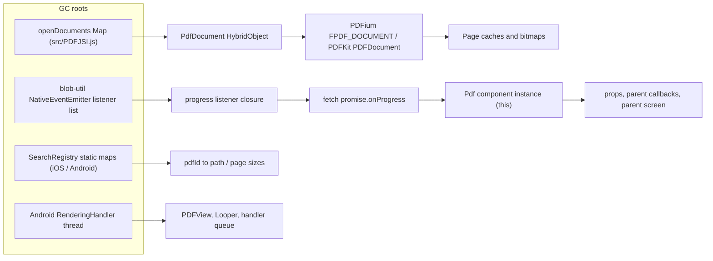

# Memory Leak Analysis

This document audits the package's core logic for memory and resource leaks: JavaScript in `index.js` and `src/`, Android native code in `android/src/main/java` and `android/src/main/cpp`, and iOS native code in `ios/RNPDFPdf`. The scenario is the one users notice: **opening and closing the same PDF repeatedly makes memory grow**.

Sections 1 to 7 are the original analysis, and their line numbers refer to the 5.0.0 tree. The fixes shipped in 5.1.0 are tracked in [section 8](#8-remediation-status-510).

---

## 1. Concept: strong references and GC roots

A reference is a way to reach an object. While an object can be reached from a garbage-collection root, the runtime must keep it alive. GC roots include the global scope, module-level variables, active closures, event-emitter listener lists, native static fields, and running threads.

```js
const cache = [];

function loadScreen() {
  const screenData = {
    pdfName: "report.pdf",
    pages: new Array(100_000).fill("page data")
  };

  cache.push(screenData);
}
```

`cache` lives at module scope and is never emptied, so every `screenData`, including its 100,000-element array, stays reachable for the life of the app. Calling `loadScreen()` ten times retains ten copies. This isn't a garbage-collector bug: the program still holds a strong reference.

### The same pattern in this package

`src/PDFJSI.js` has exactly this shape, except that what it holds is native PDF documents rather than strings:

```js
// src/PDFJSI.js lines 9-31
const openDocuments = new Map();

// ...

export async function openPdf(path) {
    const existing = openDocuments.get(path);
    if (existing) {
        return existing;
    }
    const document = await getPdfLibrary().open(path);
    openDocuments.set(path, document);
    return document;
}
```

`closePdf()` exists (lines 33–40), but nothing in the package calls it.

### Why JS garbage collection is not enough

A Nitro `HybridObject` looks small to Hermes (a few bytes of JS wrapper). Behind it sit a PDFium `FPDF_DOCUMENT` or a PDFKit `PDFDocument`, page caches, text pages, and rendered bitmaps, often many megabytes. Hermes has no view of that native memory, so it feels no pressure to collect the wrapper. Even an *unreachable* document may stay open for a long time. **Native PDF engines need an explicit `close()` / `dispose` lifecycle call**, and the JS side has to make that call.

### Reference chains found in this package



---

## 2. JavaScript findings

### High severity

#### JS-1. Native documents are cached forever and never closed

- **Where:** `src/PDFJSI.js` lines 9, 23–31 (`openPdf`), 33–40 (`closePdf`, never called), 50–60 (`ensureDocument` opens any path automatically).
- **GC root:** the module-level `openDocuments` Map.
- **What is retained:** every `PdfDocument` ever opened, along with its native document, page cache, and bitmaps.
- **Callers that open documents and never close them:**
  - `index.js` lines 478, 499, 514, 531 (`this.pdfJSI.openPdf(this.state.path)`)
  - `src/EnhancedPdfView.js` lines 77, 392, 404
  - `src/hooks/usePDFJSI.js`: 12 `openPdf` calls (lines 78, 129, 146, 163, 180, 197, 214, 231, 248, 309, 326, 343)
  - `src/PDFText.js` line 22 (`withDocument`, used by every text, OCR, and page-size helper)
  - `src/managers/ExportManager.js` lines 184, 234, 443, 473
  - every `*Direct` helper in `PDFJSI.js` that goes through `ensureDocument`
- **Related bugs:**
  - **Concurrent-open race.** Two `openPdf(samePath)` calls running at the same time both miss the lookup at line 24 and both call `open()`. The second `set` overwrites the first, and the first native handle is orphaned and can never be closed.
  - **Stale handle.** `index.js` deletes the file and copies it again at the same path (lines 217–220, 280, 400). The Map still returns the document for the old file contents.
- **Same PDF opened and closed repeatedly:** the path is the same, so the Map holds a single entry. That document is never closed, though, and the entry outlives every screen. With different paths (for example, cache files named by URL hash or timestamp) the Map grows by one native document per open.
- **Fix:**
  1. Reference-count documents. `openPdf(path)` increments a count, `releasePdf(path)` decrements it, and at zero it calls `document.close()` and deletes the entry.
  2. Store the in-flight promise (`openDocuments.set(path, promise)`) so concurrent callers share one handle.
  3. Optionally add an LRU cap of 3 to 5 documents that closes the oldest.
  4. Call `releasePdf` from `Pdf.componentWillUnmount`, from `componentDidUpdate` when the source changes, from `EnhancedPdfView` and `usePDFJSI` cleanup, and in `try/finally` around single-shot uses in `PDFText` and `ExportManager`.
  5. Invalidate the entry whenever `index.js` replaces the file on disk.

#### JS-2. Each network download leaks the `Pdf` instance and its parent screen

- **Where:** `index.js` lines 356–372. The root cause is in `node_modules/react-native-blob-util/fetch.js` (v0.24.4):

  ```text
  192:  subscription = eventEmitter.addListener('ReactNativeBlobUtilProgress', ...)
  213:  subscription = eventEmitter.addListener('ReactNativeBlobUtilExpire', ...)   // overwrites line 192
  250:  subscription.remove();   // removes only the Expire listener
  304:  promise.onProgress = fn;  // never cleared
  ```

- **GC root:** blob-util's `NativeEventEmitter` listener list.
- **Chain:** the progress listener closure keeps `promise` alive. `promise.onProgress` is the arrow function at `index.js` line 364, which captures `this` (the `Pdf` instance). Through it, `this.props` keeps the parent's callbacks and the parent screen alive.
- **Effect:** one full `Pdf` instance and its screen stay in memory **per download**. This is the classic "references to old screens" leak.
- **Fix:**
  - Route progress through an indirection that can be detached, for example `task.progress((r, t) => this._onProgress && this._onProgress(r, t))`, and set `this._onProgress = null` and `task.onProgress = null` on completion and on unmount.
  - Patch blob-util with `patch-package` so it uses separate variables for the Progress and Expire subscriptions and removes both. Report the bug upstream.

#### JS-3. Downloads can never be cancelled

- **Where:** `index.js` lines 160–165, 195–203, 322–326, 356, 370.
- **Problem:** `this.lastRNBFTask` holds the result of `.catch(...)` (line 370), which is a new Promise **without** the `cancel` method blob-util attached to the original task.
  - Line 160: the guard `this.lastRNBFTask.cancel` is always falsy, so a previous download is never cancelled when the source changes. It can finish later and overwrite the new file.
  - Line 323: `this.lastRNBFTask.cancel(...)` throws `TypeError` whenever a previous download is still pending.
  - Lines 197–200: cancelling on unmount is commented out. The native request, temp file, and closure chain (lines 364–416, each capturing `this`) live until the network call finishes.
  - Line 365 calls `this.props.onLoadProgress` with no `_mounted` check, and `_onError` calls `props.onError` after unmount.
- **Fix:** keep the raw task (`const task = ReactNativeBlobUtil.config(...).fetch(...)`, `this.lastRNBFTask = task`), attach `.progress` and `.then/.catch` separately, call `task.cancel()` in `componentWillUnmount` and wherever the source changes, and guard callbacks with `this._mounted`.

### Medium severity

| ID | Where | Issue | Fix |
|---|---|---|---|
| JS-4 | `src/hooks/usePDFJSI.js` lines 24, 86–94, 107–116, 362–372 | `performanceHistoryRef` gets one entry per call and is never trimmed (the `maxCacheSize = 100` option is never applied). The cleanup effect depends on `[enablePerformanceTracking]`, so it also runs while the component is still mounted, and it never releases the documents the hook opened. `initializeJSI` calls setters with no mounted check. | Trim to `maxCacheSize` after each push. Use `[]` as the cleanup dependencies. Track opened paths and release them on unmount. |
| JS-5 | `DoubleTapView.js` lines 92–105, no `componentWillUnmount` | The `setTimeout` callback captures `this` and the parent's `onSingleTap`. Line 93 sets `this.timer = null` without `clearTimeout`, so the pending timer can't be cancelled and `onSingleTap` fires twice. | `clearTimeout(this.timer)` before line 93. Add `componentWillUnmount() { clearTimeout(this.timer); }`. |
| JS-6 | `src/EnhancedPdfView.js` line 25, lines 75–79 | `initializeJSI()` runs async from the constructor and calls `setState` without a mounted check. `ensureOpen()` opens through the global Map, and there is no `componentWillUnmount`. | Move the call to `componentDidMount`, add a `_mounted` flag, and release the document on unmount. |

### Low severity

| ID | Where | Issue | Fix |
|---|---|---|---|
| JS-7 | `src/managers/BookmarkManager.js` lines 23–24, 110–112, 291 | The singleton keeps bookmarks and progress (including `pagesRead` arrays) for every PDF for the whole session. | Load lazily per `pdfId`, or prune old entries. |
| JS-8 | `BookmarkManager.js` lines 515–521 | `getStorageSize` creates 4 native-backed `Blob`s per call and never closes them. | Measure string length instead, or call `blob.close()`. |
| JS-9 | `BookmarkManager.js` line 129 | Returns the internal cached array after sorting it in place. Callers that mutate it corrupt the cache (aliasing, not a leak). | Return `[...bookmarks].sort(...)`. |
| JS-10 | `src/PDFText.js` lines 15, 179–184 | The module-level `customOCREngine` can keep a component's closures alive until `clearOCREngine()` is called. | Document that `clearOCREngine()` should be called on unmount. |
| JS-11 | `src/utils/PerformanceLogger.js` lines 14, 28–35, 72 | Entries in the singleton `timers` Map are removed only by `endTimer`, so an operation that throws leaves its entry forever. Nothing imports the module. | Delete the module, or call `endTimer` in `finally`. |
| JS-12 | `src/managers/ExportManager.js` lines 270–274 | Merge-by-URL downloads hit the JS-2 listener leak (small retained graph here), and the temp `merge-url-*.pdf` files are never deleted (a disk leak). | Delete temp files after merging. Patch blob-util. |
| JS-13 | `src/utils/MemoizedAnalytics.js` lines 45–56, 68 | The cache is bounded (50 entries) but evicts first-in-first-out rather than LRU, and `key.includes(pdfId)` can invalidate other PDFs' entries. | `delete` then `set` on a cache hit, and match keys exactly. |
| JS-14 | `src/managers/CacheManager.js` line 22 | The `progressListeners` Map is never used. | Remove it. |

---

## 3. Android native findings

### High severity

#### AND-1. The PDF renderer thread is never stopped

- **Where:** `android/src/main/java/org/wonday/pdf/PdfView.java` lines 450–454:

  ```java
  @Override
  protected void onDetachedFromWindow() {
      // Intentionally skip super to prevent barteksc PDFView's recycle() ...
  }
  ```

- **Why it leaks:** in the barteksc `PDFView` base class, `onDetachedFromWindow()` is the only place that quits the `RenderingHandler` `HandlerThread` ("PDF renderer"). The override skips `super` to keep the document alive during navigation. `PdfManager.onDropViewInstance` (line 63) calls `recycle()`, but `recycle()` only stops the handler; it does not quit the thread.
- **GC root:** a live thread. Its Looper and handler keep the `PDFView`, and through it the `Context`, reachable.
- **Effect:** one thread, plus everything it references, stays behind per open/close cycle. This shows up as a rising thread count in Android Studio's profiler.
- **Fix:** in `recycle()`, or in a dedicated `dispose()` called from `onDropViewInstance`, quit the renderer thread after `super.recycle()`. The thread field is private in the library, so either reflect on `renderingHandlerThread` or call `super.onDetachedFromWindow()` only from the drop path, guarded by a flag. Keep skipping it for navigation detaches.

### Medium severity

| ID | Where | Issue | Fix |
|---|---|---|---|
| AND-2 | `PdfView.java` lines 495–504 | The `InputStream` from `contentResolver.openInputStream(uri)` for `content://` sources is passed to `fromStream` and never closed, so each load leaks one file descriptor. | Copy the stream to bytes or a temp file inside try-with-resources, then load from that; or close it in `loadComplete` / `onError`. |
| AND-3 | `android/src/main/cpp/HybridPdfDocument.cpp` lines 17, 31 | The `clazz` and `result` local refs are never deleted (only `jpath` is, at line 32). This runs on Nitro worker threads that don't return to Java, so local refs pile up per OCR call and can overflow the local reference table. | `env->DeleteLocalRef(result)` and `env->DeleteLocalRef(clazz)` on every path, or use `fbjni` `local_ref` wrappers. |
| AND-4 | `android/src/main/cpp/PdfDiskCache.cpp` lines 31–39 | `threadClass`, `application`, `contextClass`, `cacheDir`, `fileClass`, and `path` are never deleted. Same accumulation risk as AND-3 on every `cacheDirectory()` call. | Delete each local ref, or compute the directory once and store it in a static. |
| AND-5 | `android/src/main/java/org/wonday/pdf/PdfOcr.java` lines 74–83 | `recognizer.close()` is called only on the success path. If `Tasks.await` or `getText` throws, the ML Kit recognizer and its native model resources are never released. | Wrap lines 75–82 in `try { ... } finally { close }`. |
| AND-6 | Nitro `HybridPdfDocument` in general | Hermes can't see the native size of a document, so documents that JS forgets to `close()` (see JS-1) are collected late or not at all. | Fix JS-1, and optionally report native memory size to Nitro (`getExternalMemorySize`) so the GC sees the real cost. |

### Low severity

| ID | Where | Issue | Fix |
|---|---|---|---|
| AND-7 | `android/src/main/cpp/PdfiumSession.cpp` line 911 | In `pdfiumSplit`, if `saveToMemory(piece)` throws, `piece` is never closed. The catch block (line 915) closes only `source`. | Close `piece` inside a scope guard (`ScopedFPDFDocument` from `fpdf_scopers.h`). |

### Done correctly (Android)

- Except for AND-7, every `FPDF_DOCUMENT` is closed on both success and error paths (`PdfiumSession.cpp` lines 581, 873–880, 908–916, 942–1006).
- `PdfOcr.renderPage` closes `PdfRenderer` (try-with-resources), `Page`, and `ParcelFileDescriptor`, and recycles the `Bitmap` in `finally` (lines 40–66).
- The disk cache is bounded (`kMaxFiles = 100`, `PdfDiskCache.cpp` line 20).
- `PdfView.recycle()` unregisters `SearchRegistry` (lines 457–461), and `onDropViewInstance` calls `recycle()`.
- There are no global JNI refs and no `shared_ptr` cycles in the C++ layer.

---

## 4. iOS native findings

### High severity

#### IOS-1. Recycle cleanup never runs, and `dealloc` misses the registry

- **Where:** `ios/RNPDFPdf/RNPDFPdfView.mm` lines 387–412.
- **Problem:** `shouldBeRecycled` returns `NO`, so Fabric never calls `prepareForRecycle`. That method is the only place that unregisters `SearchRegistry`, removes `_pdfView` from its superview, and clears `_highlightOverlay` and the gesture recognizers. Teardown then depends entirely on `dealloc` (lines 1021–1042). `dealloc` does clear caches and set `_pdfDocument`/`_pdfView` to `Nil`, but it **does not** call `[SearchRegistry unregisterPath:_pdfId]`.
- **Effect:** static `SearchRegistry` entries (IOS-5) outlive the view. If anything else holds a strong reference to the view, the document stays alive too, because nothing releases it any earlier.
- **Fix:** add a single `- (void)teardown` that unregisters `SearchRegistry`, cancels `_preloadQueue`, clears caches, sets `_pdfView.document = nil`, and removes observers. Call it from `dealloc`, from `prepareForRecycle`, and from `invalidate` if the component adopts `RCTInvalidating`.

### Medium severity

| ID | Where | Issue | Fix |
|---|---|---|---|
| IOS-2 | `RNPDFPdfView.mm` lines 401–403, 1035–1037 | `removeObserver` uses string literals such as `@"PDFViewDocumentChangedNotification"`, which don't match the PDFKit constants registered at lines 533–535. The removal calls do nothing. On iOS 9 and later, block-less observers are removed automatically at `dealloc`, so impact is low, but the code is misleading and breaks if teardown moves earlier. | Use `PDFViewDocumentChangedNotification`, `PDFViewPageChangedNotification`, and `PDFViewScaleChangedNotification`, or call `removeObserver:self`. |
| IOS-3 | `RNPDFPdfView.mm` lines 201–204, 1760–1795 | `_searchCache` (whole result arrays per query) and `_pageCache` are unbounded `NSMutableDictionary`s and aren't cleared when the document changes. They are cleared only in `dealloc` and by the explicit clear method (lines 1729–1731). | Use `NSCache` with `countLimit`, and clear both when the document changes. |
| IOS-4 | `RNPDFPdfView.mm`, load and error path | After a wrong password or open failure, the previous document stays attached to `_pdfView`. | Set `_pdfView.document = nil` before loading the new document. |
| IOS-5 | `ios/RNPDFPdf/SearchRegistry.m` lines 8–9 | Static `_pathByPdfId` and `_pageSizeByKey` dictionaries grow when a different `pdfId` is used on each mount, because of IOS-1. | Fix IOS-1; also remove the `pdfId_*` page-size keys on unregister. |
| IOS-6 | `RNPDFPdfView.mm` `exportToImages`; `HybridPdfDocument.swift` export loops | Every page is rendered into memory before any encoding, and the Swift loops have no `autoreleasepool`, so peak memory scales with page count. | Encode and write each page inside `@autoreleasepool` / `autoreleasepool {}` and drop the image right away. |

### Done correctly (iOS)

- `dealloc` cancels `_preloadQueue`, clears all four caches, and sets the document, view, and gesture recognizers to nil (lines 1021–1042).
- `updateProps` unregisters the old `pdfId` before registering a new one (lines 359–370).
- No block-based retain cycle was found that keeps `RNPDFPdfView` alive.

---

## 5. Reproduce, inspect, and verify

### Step 1: Reproduce

1. Build the example app in **release-like** mode (Hermes enabled, dev mode off) so dev-only retention doesn't hide results.
2. Use a fixed local PDF (about 20 MB, 100+ pages) and a remote URL for the download path.
3. Script or tap through this sequence **20 times**: navigate to the PDF screen, wait for `onLoadComplete`, scroll a few pages, run one search, then go back.
4. Force a GC after each cycle (Android Studio "Force GC", or Hermes `global.gc?.()` in a debug build), then record:
   - Android: Java heap, Native heap, Graphics, **thread count** (Android Studio Memory/CPU Profiler), and FD count (`ls /proc/<pid>/fd | wc -l`).
   - iOS: Persistent bytes in Instruments **Allocations**, **Leaks**, and the Xcode **Memory Graph**.
   - JS: a Hermes heap snapshot after cycles 1, 10, and 20 (React Native DevTools, Memory tab).

### Step 2: Inspect JavaScript memory

Compare the heap snapshots from cycles 1 and 20 and filter by "Objects allocated between snapshots".

| Look for | Expected if leaking | Finding |
|---|---|---|
| `Pdf` instances (constructor name) | Count grows by 1 per remote-source cycle | JS-2, JS-3 |
| Retainer path: `NativeEventEmitter`, then a listener, then a closure, then `promise`, then `onProgress` | Present on retained `Pdf` instances | JS-2 |
| `HybridObject` / `PdfDocument` wrappers | Retained by `openDocuments` (`Map`) | JS-1 |
| Large arrays inside `performanceHistoryRef` | Grows per render call | JS-4 |
| `Timeout` objects retaining `DoubleTapView` | Present after unmount | JS-5 |

### Step 3: Inspect native memory

| Platform | Signal | Expected if leaking | Finding |
|---|---|---|---|
| Android | Threads named "PDF renderer" | +1 per cycle | AND-1 |
| Android | Open FDs (`content://` source) | +1 per cycle | AND-2 |
| Android | Native heap after GC | Grows in steps the size of the document | JS-1, AND-6 |
| Android | `JNI ERROR: local reference table overflow` on long OCR/cache runs | Crash after many calls | AND-3, AND-4 |
| iOS | `PDFDocument` / `CGPDFDocument` live count in Allocations | Doesn't drop to 0 after back navigation | JS-1, IOS-1 |
| iOS | `RNPDFPdfView` in Memory Graph after back | Should be 0 | IOS-1 |
| iOS | `SearchRegistry` dictionary size | Grows with distinct `pdfId`s | IOS-5 |

### Step 4: Verify the fix

1. Re-run Step 1 with the fixes applied.
2. **Pass criteria:**
   - After a warm-up (cycles 1–3), Java heap, Native heap, and iOS persistent bytes stay flat (within about 5% between cycles 10 and 20).
   - Thread count and FD count return to baseline after each back navigation.
   - Cycle-20 heap snapshot: 0 `Pdf` instances while the PDF screen is closed, and `openDocuments.size === 0`.
   - Xcode Leaks reports no leaks, and Memory Graph shows no `RNPDFPdfView` after leaving the screen.
3. **Functional regression checks:** returning to the screen still renders correctly (the reason AND-1's override exists), plus page jump, search highlights, password PDFs, `content://` sources, remote downloads with progress, cancelling mid-download by navigating away, OCR, and export/merge/split.

---

## 6. Recommended fix order

1. **JS document lifecycle (JS-1).** Reference-counted `openPdf`/`releasePdf`, an in-flight promise in the Map, an optional LRU cap, and release calls from every component and helper that opens a document. This is the largest single source of retained native memory on both platforms.
2. **Download lifecycle (JS-2, JS-3).** Keep the raw blob-util task, cancel it on unmount and on source change, detach `onProgress`, and patch the blob-util listener bug.
3. **Android teardown (AND-1, AND-2).** Quit the renderer thread on drop only, and close the `content://` stream.
4. **iOS teardown (IOS-1, IOS-2, IOS-5).** One `teardown` method called from `dealloc`, `prepareForRecycle`, and `invalidate`, using the correct PDFKit notification constants.
5. **JNI and resource hygiene (AND-3, AND-4, AND-5, AND-7).**
6. **Bounded caches and timers (JS-4, JS-5, JS-6, IOS-3, IOS-4, IOS-6).**
7. **Low-severity JS items (JS-7 to JS-14).**

## 7. Done correctly (JavaScript)

- `Pdf` (`index.js`) sets `_mounted` (lines 191, 196) and checks it before `setState` at lines 142, 228, 240, and 366.
- `PinchZoomView.js` and `PdfViewFlatList.js` hold no timers, global listeners, or retained data.
- `CacheManager.storeBase64` removes its subscription in `finally` (lines 51–61, 81–86).
- `MemoizedAnalytics` is size-bounded (50 entries) and expires entries after 60 seconds.
- `progressiveLoadPages` (`PDFJSI.js` lines 138–175) uses a call-local `inFlight` Set that empties as tasks finish.
- `closePdf` itself is correct (it calls `document.close()` and removes the entry). It just has no callers.
- No component subscribes to `AppState`, `Dimensions`, `DeviceEventEmitter`, or `Linking` without removing the subscription.

---

## 8. Remediation status (5.1.0)

All findings above are fixed in code on branch `fix/memory-leaks`. Unit tests cover the JS document registry (`npm test`, `src/__tests__/documentRegistry.test.js`). Native changes were syntax-checked only; they still need the device protocol in section 5.

| Finding | Fix | Where |
|---|---|---|
| JS-1 | Reference-counted registry: `withPdfDocument`, `acquirePdf`/`releasePdf`, shared in-flight open, 2-document warm pool, `invalidatePdf`, `trimPdfCache` on memory warning. `openPdf` pins; internal callers no longer pin. `index.js` invalidates cache files before overwriting them. | `src/PDFJSI.js`, all call sites |
| JS-2 | Raw blob-util task kept; `task.onProgress = null` in `finally` cuts the leaked listener's path to the component. | `index.js` `_downloadFile` |
| JS-3 | `_cancelDownload()` on unmount, source change and before a new download; load generation token drops results from superseded loads; callbacks gated on mount + generation. | `index.js` |
| JS-4 | History capped at `maxCacheSize`; cleanup effect runs on unmount only; mounted guard. | `src/hooks/usePDFJSI.js` |
| JS-5 | `clearTimeout` before firing a single tap; `componentWillUnmount` clears the timer. | `DoubleTapView.js` |
| JS-6 | Init moved to `componentDidMount`; mounted guard; no pinned opens. | `src/EnhancedPdfView.js` |
| JS-8, JS-9 | No Blobs in `getStorageSize`; `getBookmarks` returns a copy. | `src/managers/BookmarkManager.js` |
| JS-10 | `clearOCREngine()` usage documented. | `README.md` |
| JS-11 | Module removed. | `src/utils/PerformanceLogger.js` |
| JS-12 | Temp `merge-url-*.pdf` files deleted in `finally`. | `src/managers/ExportManager.js` |
| JS-13 | LRU on hit; invalidation matches the stored `pdfId` exactly. | `src/utils/MemoizedAnalytics.js` |
| JS-14 | Unused map removed. | `src/managers/CacheManager.js` |
| AND-1 | `PdfView.dispose()` (called from `onDropViewInstance`) recycles and quits `renderingHandlerThread` through a cached reflective field. Navigation detach still skips `super`. The manager no longer keeps a field pointing at the last created view. | `PdfView.java`, `PdfManager.java` |
| AND-2 | `content://` read into bytes inside try-with-resources, loaded with `fromBytes`. | `PdfView.java` |
| AND-3, AND-4 | Local refs deleted; cache directory resolved once. | `HybridPdfDocument.cpp`, `HybridPdfLibrary.cpp`, `PdfDiskCache.cpp` |
| AND-5 | Recognizer closed in `finally`. | `PdfOcr.java` |
| AND-6 | `getExternalMemorySize()` / `memorySize` report the file size while open. | `HybridPdfDocument.cpp/.hpp`, `HybridPdfDocument.swift` |
| AND-7 | `piece` closed when `saveToMemory` throws (same `try/catch` idiom as the merge, extract and compress paths). | `PdfiumSession.cpp` |
| IOS-1, IOS-5 | One `teardown` method called from `dealloc` and `prepareForRecycle`: unregisters `SearchRegistry`, cancels preloads, clears caches, detaches and releases the document and view. | `RNPDFPdfView.mm` |
| IOS-2 | Observers removed with the PDFKit constants rather than string literals. | `RNPDFPdfView.mm` |
| IOS-3 | `_searchCache` is an `NSCache` (limit 50); per-document caches cleared when the path changes. | `RNPDFPdfView.mm` |
| IOS-4 | `_pdfView.document = nil` on password and load failures. | `RNPDFPdfView.mm` |
| IOS-6 | `exportToImages` renders, encodes and writes one page at a time inside `autoreleasepool`; text-extraction loops drain per page. | `HybridPdfDocument.swift` |

**Still open:**

- The react-native-blob-util bug itself (the progress subscription is overwritten in `fetch.js` and never removed) needs an upstream fix. The package-side mitigation reduces each leaked listener to a few hundred bytes.
- JS-7: `BookmarkManager` still loads all bookmarks and progress for the session. This is bounded by stored data, not by opens.
- Device measurements below.

### Measurements

Fill in after running section 5 on a low-RAM Android device and an older iPhone (20 cycles per source type).

| Metric | Platform | 5.0.0 | 5.1.0 |
|---|---|---|---|
| Native heap growth, cycles 10 to 20 | Android | not measured | not measured |
| "PDF renderer" threads after 20 cycles | Android | not measured | not measured |
| Open file descriptors after 20 `content://` cycles | Android | not measured | not measured |
| Persistent bytes growth, cycles 10 to 20 | iOS | not measured | not measured |
| `RNPDFPdfView` instances after leaving the screen | iOS | not measured | not measured |
| `getPdfRegistryStats()` after leaving the screen | both | n/a | not measured |
