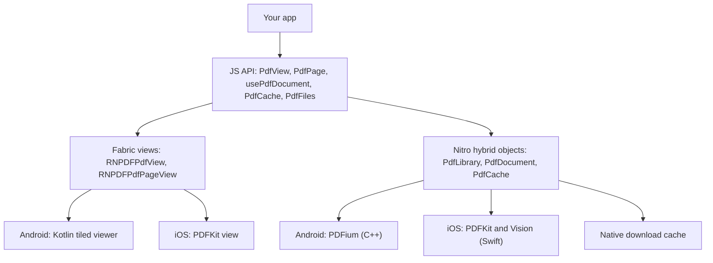

# react-native-pdf-jsi

[](https://www.npmjs.com/package/react-native-pdf-jsi)

PDF viewer and document toolkit for React Native on the New Architecture. Documents, downloads and editing live in Nitro modules; the viewer is a Fabric component that renders with PDFium on Android and PDFKit on iOS.

## Version 6.1.0

6.x is the current release and the npm `latest` tag, so a plain install gets it:

```sh
# npm
npm install react-native-pdf-jsi react-native-nitro-modules

# yarn
yarn add react-native-pdf-jsi react-native-nitro-modules

# pnpm
pnpm add react-native-pdf-jsi react-native-nitro-modules
```

Which version you get:

| Command | Installs |
| --- | --- |
| `react-native-pdf-jsi` (no version) or `@latest` | 6.1.0 (New Architecture) |
| `react-native-pdf-jsi@4.5.0` | 4.5.0 (Old Architecture) |

Apps still on the Old Architecture should pin `react-native-pdf-jsi@4.5.0`. Check what is published with `npm view react-native-pdf-jsi dist-tags`.

Upgrading from 5.x or 4.x: follow [MIGRATION-6.0.md](MIGRATION-6.0.md).

## Who should use 6.0

Use 6.0 if:

- Your app runs on the New Architecture (React Native 0.76 or newer).
- You want the viewer to scroll and zoom natively, with no JavaScript work per frame.
- You open remote PDFs and need them cached, available offline, or fetched with auth headers.
- You need document work from JavaScript: search, text extraction, page images, editing, forms, merge, split or compression.
- You want TypeScript types and errors you can match on.

Stay on 4.5.0 if:

- Your app still uses the Old Architecture (Paper). 6.0 has no fallback.
- You ship on Windows.
- You can't take a breaking upgrade yet: 6.0 changes viewer props and makes every page index zero-based.

## Main benefits

- **One native dependency.** `react-native-nitro-modules` is the only native peer. `react-native-blob-util`, AsyncStorage, `crypto-js`, AndroidPdfViewer, `pdfiumandroid` and Gson are no longer needed.
- **Native viewer.** Android renders pages in tiles on a background thread; iOS uses PDFKit. Page and zoom events arrive once scrolling settles, not on every frame.
- **Dependable downloads.** Remote documents are revalidated with ETag / Last-Modified, served from disk when offline, resumed after an interruption (files of 32 MB and more), shared between concurrent requests, and kept under a size limit.
- **Predictable API.** Pages are zero-based everywhere. Taps, highlights and search results share one coordinate system. Failures are `PdfError`s with stable codes.
- **Safe editing.** Rotations, deletions, annotations and form values stay in memory until you call `save(path)`.
- **Memory you can control.** Open documents are reference-counted and shared, with a small warm pool that empties on memory warnings.
- **TypeScript.** The package is written in TypeScript and ships generated type declarations.

## Architecture



### Decisions in 6.0

**Nitro owns documents, Fabric owns the screen.** Opening, rendering, searching, editing and downloading are Nitro hybrid objects (`PdfLibrary`, `PdfDocument`, `PdfCache`) called directly over JSI. The Fabric components (`PdfView`, `PdfPage`) only display. A document opened from JavaScript is the same one a view or thumbnail draws, so edits show without reopening the file.

**Android has its own viewer on PDFium.** AndroidPdfViewer was replaced by a Kotlin viewer: one bitmap per visible page, plus 512 px tiles when zoomed in, rendered by a single prioritised thread. Bitmaps are kept in a cache measured in bytes that shrinks under memory pressure, so large documents stay within a fixed budget.

**iOS uses the system engines.** PDFKit draws pages and Vision handles OCR, so nothing is bundled on iOS.

**Downloads moved into native code.** `PdfCache` streams files straight to disk on a native thread instead of passing them through JavaScript with blob-util. Three cache modes cover the common cases: `none` (fresh each time), `session` (default, size-limited) and `persistent` (kept until removed).

**One page and coordinate convention.** Every API takes and returns zero-based pages. Positions are PDF points from the top-left corner of the displayed page, so a search result's `rect` can be passed straight to `highlights`.

**Errors are values with codes.** Every rejection and viewer error is a `PdfError` whose `code` (`download-failed`, `password-required`, `invalid-page`, …) is the same on both platforms.

**Edits are explicit.** Changes to a document are held in memory and written only by `save(path)`, so the source file is never modified by accident.

**New Architecture only.** Dropping the Old Architecture and Windows keeps one code path per platform.

## Requirements

| | |
| --- | --- |
| React Native | 0.76 or newer, New Architecture enabled |
| `react-native-nitro-modules` | ^0.37.1 |
| iOS | 13.0+ |
| Android | minSdkVersion 21+ |
| Expo | Development build (Expo Go is not supported) |

## Installation

### React Native CLI

```sh
npm install react-native-pdf-jsi react-native-nitro-modules
cd ios && pod install
```

To show saved files in the iOS Files app, add `UIFileSharingEnabled` and `LSSupportsOpeningDocumentsInPlace` (both `true`) to `Info.plist`. See [Saving files](#saving-files).

### Expo

```sh
npx expo install react-native-pdf-jsi react-native-nitro-modules
```

```json
{
  "expo": {
    "plugins": [["react-native-pdf-jsi", { "ocr": false }]]
  }
}
```

Then run `npx expo prebuild --clean`. The plugin turns on the New Architecture, checks that `react-native-nitro-modules` is installed, and adds the iOS Files app keys. Options:

- `ocr`: enables Android ML Kit text recognition. iOS OCR uses Vision and needs nothing.
- `iosFileSharing`: set to `false` to leave `Info.plist` alone.

Step-by-step Expo setup, code changes and Xcode 27 / iOS 27 fixes: [EXPO-6.0.md](EXPO-6.0.md).

## Quick start

```tsx
import { useRef } from 'react';
import { PdfView, type PdfViewRef } from 'react-native-pdf-jsi';

export function Reader() {
  const viewer = useRef<PdfViewRef>(null);

  return (
    <PdfView
      ref={viewer}
      style={{ flex: 1 }}
      source={{ uri: 'https://example.com/report.pdf', cache: 'persistent' }}
      onLoad={({ pageCount }) => {
        console.log('pages', pageCount);
        viewer.current?.goToPage(4);
        viewer.current?.zoomTo(2, { animated: true });
      }}
      onPageChange={({ page, pageCount }) => console.log(`${page + 1}/${pageCount}`)}
      onError={(error) => console.warn(error.code, error.message)}
    />
  );
}
```

Other viewer props include `initialPage`, `initialScale`, `horizontal`, `enablePaging`, `enableRTL`, `fitPolicy` (`'width' | 'height' | 'page'`), `highlights`, `password` and `onPasswordRequired`. The full list is in [MIGRATION-6.0.md](MIGRATION-6.0.md#props).

## Core APIs

### Sources

```ts
{ uri: 'https://…', headers: { Authorization: 'Bearer …' } } // session cache (default)
{ uri: 'https://…', cache: 'persistent' }                    // kept until removed, still revalidated
{ uri: 'https://…', cache: 'none' }                          // downloaded every time
{ uri: 'https://…', maxAgeMs: 60_000, cacheKey: 'invoice-42' }
{ filePath: '/path/to/file.pdf' }
{ base64: 'JVBERi0…' }
require('./manual.pdf')
```

```ts
import { PdfCache } from 'react-native-pdf-jsi';

await PdfCache.download({ uri, cache: 'persistent' }); // fetch ahead of time
PdfCache.maxCacheBytes = 500 * 1024 * 1024;            // session cache limit
await PdfCache.clear();
```

### Documents and thumbnails

```tsx
import { PdfPage, usePdfDocument } from 'react-native-pdf-jsi';

function Thumbnail({ uri }: { uri: string }) {
  const { document } = usePdfDocument({ uri });
  if (!document) return null;
  return <PdfPage document={document} page={0} style={{ height: 120 }} />;
}
```

### Rendering, search and editing

```ts
const image = await document.renderPage(0, { maxWidth: 1080, format: 'jpeg', quality: 85 });
const matches = await document.searchText('invoice', 0, document.pageCount - 1); // rects fit `highlights`
const text = await document.extractText(0);

await document.rotatePage(0, 90);
await document.deletePage(3);
await document.addAnnotation({ page: 0, type: 'highlight', rect: { x: 72, y: 72, width: 200, height: 20 } });
await document.setFormFieldValues({ name: 'Ada' });
await document.save(outputPath); // nothing is written before this
```

Saving with a password is supported on iOS; on Android it rejects with `unsupported-operation`.

### Merge, split, extract, compress

```ts
import { getPdfLibrary } from 'react-native-pdf-jsi';

const library = getPdfLibrary();
await library.mergePDFs([a, b], outputPath);
await library.splitPDF(filePath, JSON.stringify([[0, 9], [10, 19]]), outputDir);
await library.extractPages(filePath, JSON.stringify([0, 2]), outputPath);
await library.compressPDF(inputPath, outputPath, 6);
```

### Document lifecycle

A native document holds PDFium / PDFKit memory that the JavaScript garbage collector cannot see. `usePdfDocument` releases it on unmount. Outside components, prefer `withPdfDocument`, which releases the document even if the callback throws:

```ts
import { withPdfDocument } from 'react-native-pdf-jsi';

const text = await withPdfDocument(filePath, (document) => document.extractText(0));
```

For a document that stays open across several calls, pair `acquirePdf` with `releasePdf`:

```ts
import { acquirePdf, releasePdf } from 'react-native-pdf-jsi';

useEffect(() => {
  acquirePdf(filePath).then(setDocument, setError);
  return () => releasePdf(filePath);
}, [filePath]);
```

- Concurrent opens of the same path share one native document.
- Released documents stay in a warm pool of 2 so reopening is instant. The pool empties on memory warnings, or call `trimPdfCache()`.
- Call `invalidatePdf(path)` after overwriting a file, so the next open reads the new contents.
- `getPdfRegistryStats()` reports open, referenced, pinned, warm and stale counts, which helps when checking for leaks.

## Saving files

`PdfFiles.saveToDownloads(path, fileName)` (or `FileManager.downloadToPublicFolder`) saves a copy natively: into the public Downloads folder through MediaStore on Android, and into the app's Documents folder on iOS.

On iOS the Documents folder shows in the Files app only when the app's `Info.plist` sets `UIFileSharingEnabled` and `LSSupportsOpeningDocumentsInPlace` to `true`. The Expo plugin adds both (opt out with `{ "iosFileSharing": false }`); bare apps add them by hand. `FileManager.openDownloadsFolder()` opens the app's folder in the Files app.

Paths returned for viewed documents point into the library's cache. To keep a document, load it with `cache: 'persistent'` or copy it with ``PdfFiles.copy(path, `${PdfFiles.documentDirectory}/name.pdf`)``.

## Errors

```ts
import { isPdfError } from 'react-native-pdf-jsi';

try {
  await document.renderPage(99);
} catch (error) {
  if (isPdfError(error) && error.code === 'invalid-page') {
    // …
  }
}
```

Codes: `invalid-source`, `download-failed`, `password-required`, `password-incorrect`, `unsupported-pdf`, `page-render-failed`, `out-of-memory`, `invalid-page`, `invalid-argument`, `unsupported-operation`, `io-error`, `cancelled`, `document-closed`, `unknown`. Match on `code`; messages may change. `errorMessageFor(error)` returns a readable English message.

## Upgrading

- From 5.x or 4.x to 6.0: [MIGRATION-6.0.md](MIGRATION-6.0.md)
- Expo apps on 6.0: [EXPO-6.0.md](EXPO-6.0.md)
- From 4.x to 5.0: [MIGRATION-5.0.md](MIGRATION-5.0.md)
- Release notes: [CHANGELOG.md](CHANGELOG.md)

## Commercial Nitro Edition & Support

react-native-pdf-jsi has crossed 223K downloads. Thank you to everyone who has used the library and supported its development.

I've recently worked on a complete migration to Nitro Modules and am exploring a paid offering for developers and teams interested in this implementation.

### What's included?

- Access to the Nitro-based implementation under a commercial license, where applicable.
- Assistance with setup and integration.
- Help troubleshooting native Android and iOS build issues.
- Direct support from the maintainer.

### Interested in the Nitro Edition?

The Nitro Edition and dedicated support will be available as a paid offering. Pricing and licensing details can be discussed based on your requirements.

Contact: [punithm865@gmail.com](mailto:punithm865@gmail.com)

### Want to support the ongoing development of the open-source version?

[Become a GitHub Sponsor](https://github.com/sponsors/126punith)

Your support helps me maintain the library and continue building for the React Native community.
